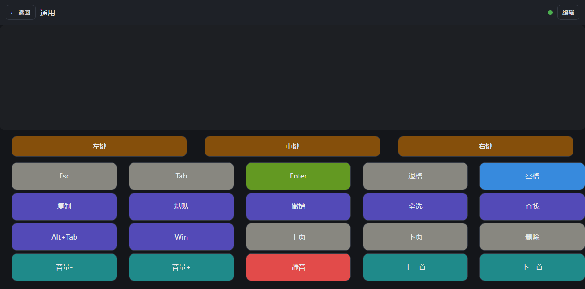

# wifi-panel


**把手机浏览器变成电脑的鼠标键盘，同时当电视遥控器用。** 面板上的按钮位置、大小、颜色、动作全部自定义——想做成游戏手柄、电视遥控，还是办公快捷键板，都随你。

中枢跑在 NAS / 服务器的 Docker 里，电脑上只装一个几百 KB 的 Agent，手机上什么都不用装（浏览器打开即用）。



---

## 特性

- **可编程面板**：按钮自由拖放定位、调整大小与配色，动作支持键盘单击 / 按住持续 / 组合键、鼠标左中右键、系统媒体键、电视按键、电视启动应用。
- **触控板手势**：单指滑动移动鼠标，轻点左键，双指滑动滚轮，双指轻点右键。
- **5 种内置模板**：通用 / 游戏手柄 / 媒体控制 / 电视遥控 / 空白。首次启动自动生成一个「通用」默认面板，打开就能用。
- **电视多协议**：Android TV 系走 ADB，三星 Tizen 与 LG webOS 走各自的原生 WebSocket 协议，主流品牌基本覆盖。
- **不依赖 PC 开机控电视**：电视指令由中枢（NAS 上）直接执行，电脑关着也能用手机换台、调音量。
- **PC 端零端口**：Agent 主动外连中枢，电脑不用开端口、不用动防火墙，放在任何内网机器上都能接。
- **防按键卡死**：手机断线、切后台、来电话时，中枢会释放该设备按住的全部按键，不会出现「一直往前走」。
- **零前端依赖**：手机端是原生 JS 单页，无需构建、无需安装 App。

## 工作原理

```
手机浏览器 ──WebSocket──▶ 中枢（NAS · Docker） ──┬── ADB / SSAP / Tizen ──▶ 电视
                       网页 + 布局存储 + 转发    └── WebSocket 回连 ──▶ PC Agent（注入鼠标键盘）
```

- **中枢**（`server/`）：FastAPI + WebSocket。托管网页、存储面板配置、把手机指令转发给 Agent，电视指令本地执行。
- **PC Agent**（`agent/`）：主动外连中枢，用 pynput 注入鼠标键盘事件。Windows / macOS / Linux(X11) 通用。
- **网页**（`web/`）：面板列表、编辑器、使用模式、电视设置，原生 JS 零依赖。

## 支持的设备

| 设备 | 说明 |
|------|------|
| 中枢 | 任何能跑 Docker 的机器（群晖 / 威联通 / Unraid / x86 小主机 / 树莓派），或直接跑 Python 的电脑 |
| 电脑（被控） | Windows、macOS、Linux（X11 桌面） |
| 手机（控制） | iOS / Android 的现代浏览器，同一局域网 |
| 电视 · ADB | 小米、TCL / 雷鸟、海信、创维 / 酷开、索尼、长虹、康佳等 Android TV 系 |
| 电视 · 三星 | Tizen 系统的三星智能电视 |
| 电视 · LG | webOS（2014 及以后） |

不支持：华为智慧屏（鸿蒙，协议封闭）、Apple TV（需专用协议）。

---

## 安装

### 前置条件

- 一台常开的机器跑中枢（NAS / 小主机 / 电脑），与手机、电视在同一局域网
- 中枢端口默认 `8765`
- 想控电脑的话，电脑上需要 Python 3.9+

---

### 一、中枢：Docker 部署（推荐）

镜像已发布在 GitHub Container Registry，支持 `linux/amd64` 与 `linux/arm64`（群晖 / 威联通 / x86 小主机 / ARM 板子都能跑），内置 `adb`，电视控制开箱可用。

```bash
git clone https://github.com/wodty/wifi-panel.git
cd wifi-panel
```

先设令牌，再启动：

```bash
# 方式 A：写进 .env（推荐，compose 会自动读取）
echo "PANEL_TOKEN=你的密码" > .env
docker compose up -d

# 方式 B：不用 .env，直接改 docker-compose.yml 里的 PANEL_TOKEN
```

升级到最新版本：

```bash
docker compose pull && docker compose up -d
```

面板配置、电视 IP、ADB 配对密钥都存在 `server/storage/`（已挂载为卷），升级重建容器不会丢。

<details>
<summary>不用 clone 仓库，最小启动</summary>

把下面内容存成 `docker-compose.yml`，同目录执行 `docker compose up -d`：

```yaml
services:
  panel:
    image: ghcr.io/wodty/wifi-panel:latest
    container_name: wifi-panel
    ports: ["8765:8765"]
    environment:
      - PANEL_TOKEN=你的密码
    volumes:
      - ./server/storage:/app/server/storage
    restart: unless-stopped
```

若拉取时报 `denied`，说明镜像包还是私有的，先 `docker login ghcr.io`（用户名 GitHub 账号，密码用 PAT）。
</details>

<details>
<summary>群晖 / 威联通用户</summary>

图形界面里新建「项目 / 应用」，镜像填 `ghcr.io/wodty/wifi-panel:latest`，端口映射 `8765`，目录映射 `server/storage`，环境变量填 `PANEL_TOKEN` 即可；也可以直接用本仓库的 `docker-compose.yml`。
</details>

<details>
<summary>自己构建镜像（改了代码）</summary>

```bash
docker compose build && docker compose up -d
```
（把 `docker-compose.yml` 里的 `image:` 注释掉、放开 `build: .`，或直接 `docker build -t wifi-panel .`）
</details>

---

### 镜像标签说明

| 标签 | 含义 |
|------|------|
| `latest` | 跟随 `main` 分支最新提交 |
| `1.0.0` / `1.0` | 打 `v1.0.0` 这类 git tag 时自动生成 |
| `sha-xxxxxxx` | 某次提交的精确版本，适合锁定部署 |

镜像构建与自动化测试由 GitHub Actions 完成（`.github/workflows/docker.yml`）。

---

### 二、中枢：直接跑 Python（不需要 Docker）

```bash
git clone https://github.com/wodty/wifi-panel.git
cd wifi-panel
pip install -r requirements.txt
```

Windows 用户可以直接双击 `start_hub.bat`——它会自动建虚拟环境、装依赖再启动。

手动启动：

```bash
# Windows
set PANEL_TOKEN=你的密码
python -m uvicorn server.main:app --host 0.0.0.0 --port 8765

# macOS / Linux
PANEL_TOKEN=你的密码 python -m uvicorn server.main:app --host 0.0.0.0 --port 8765
```

> 电视控制需要系统里有 `adb` 命令：Windows 装 [platform-tools](https://developer.android.com/tools/releases/platform-tools)，Debian/Ubuntu `apt install adb`，macOS `brew install android-platform-tools`。只用电脑控制则无需安装。

---

### 三、电脑端 Agent（需要控电脑鼠标键盘时）

中枢所在机器和被控电脑不是同一台时，在被控电脑上执行：

```bash
pip install -r agent/requirements.txt
python agent/agent.py ws://<中枢IP>:8765/ws/agent <你的密码>
```

Windows 可直接双击 `agent/start_agent.bat`（**先在文件开头把 `HUB` 改成中枢地址**）。

开机自启（Windows）：把编辑好的 `start_agent.bat` 快捷方式放进 `shell:startup` 目录。

**权限说明**

- macOS：首次运行需在「系统设置 → 隐私与安全性 → 辅助功能」里授权终端 / Python。
- Linux：X11 桌面可直接用；Wayland 会话下 pynput 无法注入输入事件，需切换到 X11 登录。

---

### 四、手机端

1. 手机连上同一 WiFi
2. 浏览器打开 `http://<中枢IP>:8765`
3. 输入令牌，连接

列表里已有一个「通用」默认面板：触控板 + 鼠标三键 + PC 常用键 + 电视遥控区（方向环 / OK / 返回 / 桌面 / 音量），点「使用」就能同时控制电脑和电视；点「编辑」可以改按钮，或点「+ 新建面板」从模板开始。

> 想把页面加到主屏幕全屏使用，需要 HTTPS（局域网 `http://IP` 属于非安全上下文，PWA 无法安装）。可用 Tailscale 或自建内网域名 + 证书。

---

### 五、电视端

手机上面板列表右上角「电视」→ 选协议 → 填电视 IP（端口自动带出）→ 保存 → 连接测试。然后新建「电视遥控」模板面板。

**ADB 系（小米 / TCL·雷鸟 / 海信 / 创维 / 索尼 / 长虹 / 康佳）**

1. 电视：设置 → 关于 → 连点「软件版本」7 次，开启开发者模式
2. 开发者选项 → 打开「网络调试 / USB 调试（网络）」
3. 中枢点「连接测试」，电视上弹出授权框，勾选「一律允许」

**三星 Tizen**：首次连接电视会弹出「允许」，确认即可，令牌自动保存。

**LG webOS**：首次连接电视屏幕弹出「允许」，确认后配对密钥自动保存。

> 电视控制的安全性：ADB 端口长期开放存在被内网其他设备利用的风险。建议在路由器上只允许中枢 IP 访问电视对应端口，或不用时关闭网络调试。

---

## 配置项

| 环境变量 | 默认值 | 说明 |
|----------|--------|------|
| `PANEL_TOKEN` | `panel123` | 访问令牌，网页与 Agent 共用。**部署前务必修改** |
| `PANEL_PORT` | `8765` | 以 `python -m server.main` 方式启动时的监听端口 |

## 常见问题

**手机打不开页面？**
确认手机和中枢在同一 WiFi；用中枢机器的局域网 IP（不是 `127.0.0.1`）；中枢机器防火墙放行 8765。

**按按钮电脑没反应？**
页面右上角有连接状态点：灰点表示 Agent 未连接。检查 Agent 是否在运行、令牌是否与中枢一致、Agent 里的中枢地址是否正确。

**电视连接失败？**
电视网络调试未开、IP 变了（建议在路由器固定 IP）、或首次授权没点「一律允许」。ADB 授权异常时可删除 `server/storage/adb_key` 后重新连接。

**电视按键无效但显示已连接？**
电视可能处于待机，先按「唤醒」。

**Ctrl / Shift 之类的键按了不放开？**
不会出现。手机断开连接时中枢会释放该设备的全部按键；如遇异常，重启 Agent 即可。

## 目录结构

```
wifi-panel/
├── server/                 # 中枢：FastAPI + WebSocket
│   ├── main.py             #   路由、中继、断线释放
│   ├── templates.py        #   内置面板模板（唯一数据源）
│   ├── tv.py               #   电视控制门面
│   ├── tv_adb.py           #   ADB 后端
│   ├── tv_samsung.py       #   三星 Tizen 后端
│   ├── tv_lg.py            #   LG webOS 后端
│   └── storage/            #   面板配置 / 电视密钥（运行时生成）
├── agent/agent.py          # 被控电脑上的输入注入 Agent
├── web/                    # 手机端网页（原生 JS）
├── tests/                  # 冒烟测试
├── Dockerfile
├── docker-compose.yml
├── start_hub.bat           # Windows 一键启动中枢
└── agent/start_agent.bat   # Windows 一键启动 Agent
```

## 许可

MIT
